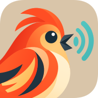
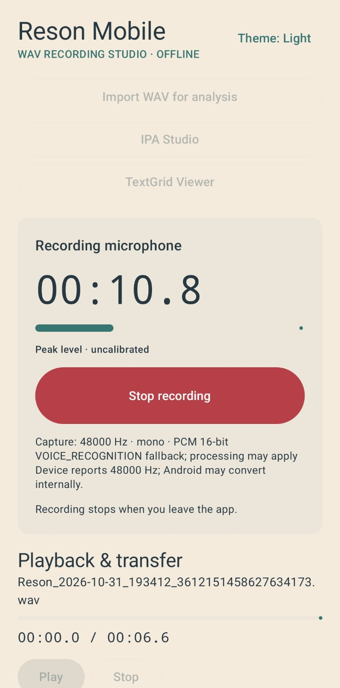
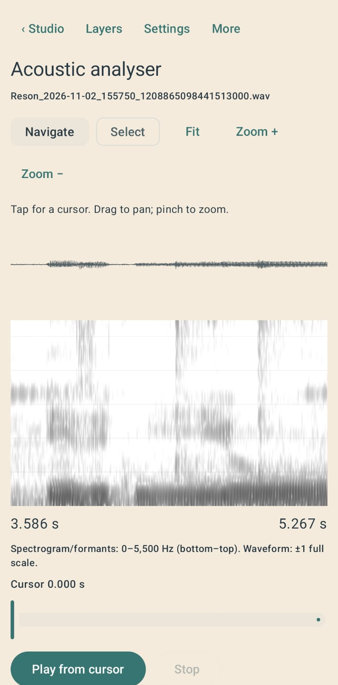
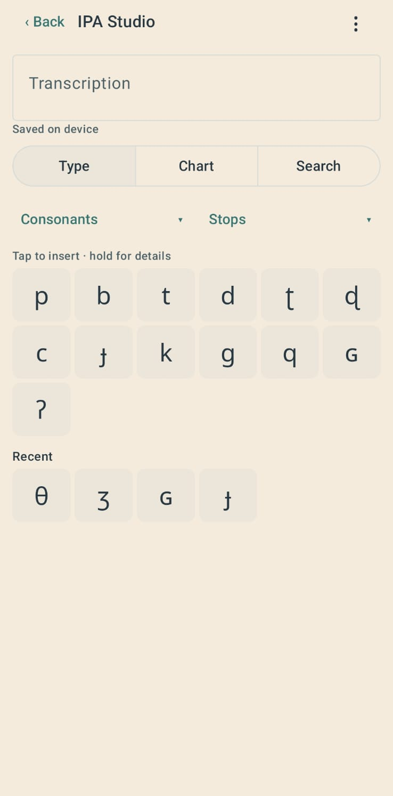
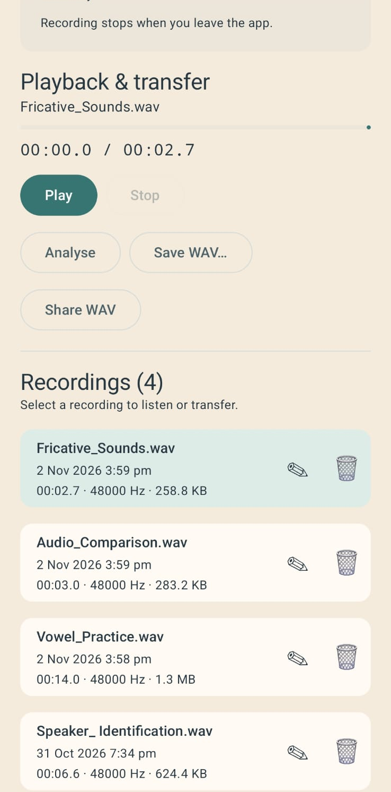

<p align="center">
  
</p>

<h1 align="center">Reson</h1>

<p align="center">Speech recording, acoustic analysis and IPA tools for Android.</p>

<p align="center">
  <a href="https://github.com/erbreta/Reson-Mobile/releases/download/v1.0.0/Reson-v1.0.0.apk"><strong>Download Reson v1.0.0 for Android</strong></a>
  &nbsp;·&nbsp;
  <a href="https://github.com/erbreta/Reson-Mobile/releases/tag/v1.0.0">Release notes</a>
  &nbsp;·&nbsp;
  <a href="https://github.com/erbreta/Reson-Mobile">Source code</a>
</p>

Reson is an offline Android app for recording speech and exploring acoustic and phonetic information on a phone. It brings together a recorder, visual analyser, IPA reference and read-only Praat TextGrid viewer.

## What you can do

- **Record and manage speech.** Capture mono WAV recordings, listen again, rename or delete them, and import, export or share supported files.
- **Explore acoustic structure.** Inspect waveforms and spectrograms, with estimates for pitch, formant candidates, intensity and periodic pulse locations. Place a cursor or select an interval to inspect the signal.
- **Use IPA Studio.** Browse symbols, search by name or feature, explore vowel and consonant charts, and edit a transcription saved locally on the device.
- **Read TextGrids.** Open supported Praat TextGrid files, inspect interval and point tiers, and associate annotations with a saved Reson recording. The viewer is read-only and leaves the source file unchanged.

## Screenshots

<table>
  <tr>
    <td align="center"><br><sub>Recording and playback</sub></td>
    <td align="center"><br><sub>Acoustic analyser</sub></td>
  </tr>
  <tr>
    <td align="center"><br><sub>IPA Studio</sub></td>
    <td align="center"><br><sub>Recordings library</sub></td>
  </tr>
</table>

## Requirements and supported audio

- **Android 10 (API 29) or newer.**
- Reson records mono, 16-bit PCM WAV audio.
- WAV imports must be uncompressed PCM16, mono or stereo, at 16,000–96,000 Hz. Stereo channels are averaged into a mono analysis copy. Float, 24-bit and extensible WAV files are not supported.

## Install

1. [Download the official v1.0.0 APK](https://github.com/erbreta/Reson-Mobile/releases/download/v1.0.0/Reson-v1.0.0.apk).
2. Open the downloaded APK on your Android device.
3. If Android asks, allow installation from the app you used to open the file, then continue with the installation.
4. Open Reson.

The official APK uses Reson's production signing certificate. Android generally cannot install it as an update over an earlier debug-signed build with the same app ID. Export any recordings you want to keep before uninstalling a debug build; uninstalling removes that build's private app data. Future updates must use the same production signing certificate.

## Build from source

Reson uses Kotlin, Jetpack Compose and the Gradle wrapper. Building requires JDK 21 and Android SDK Platform 36. The first build may need internet access to download Gradle and Android dependencies.

From the repository root, run:

```sh
./gradlew :app:testDebugUnitTest :app:lintDebug :app:assembleDebug --no-daemon
```

On Windows PowerShell, replace `./gradlew` with `.\gradlew.bat`. To install the debug build on a connected device or emulator, run `./gradlew :app:installDebug --no-daemon`.

Release builds use an external `~/.android/reson-signing/signing.properties` file and the permanent production keystore. Keep both outside the repository. Gradle deliberately fails release packaging if that signing configuration is missing or invalid.

After configuring the signing files locally, build a signed release with `./gradlew :app:assembleRelease --no-daemon` (or `.\gradlew.bat :app:assembleRelease --no-daemon` on Windows).

## Scientific notes

Acoustic measurements are estimates and depend on the recording and analysis settings. Existing comparisons use selected synthetic reference signals; comprehensive natural-speech validation and equivalence with Praat have not been established. See the [analysis methods and limitations](docs/ANALYSIS.md) and [Praat comparison results](validation/2026-10-31-praat.md).

## Project documentation

- [IPA Studio](docs/IPA_STUDIO.md)
- [TextGrid Viewer](docs/TEXTGRID_VIEWER.md)
- [Privacy](PRIVACY.md)

## Licence

Reson's source code is licensed under the [Apache License 2.0](LICENSE). The bundled Noto Sans font has a separate [SIL Open Font License](app/src/main/assets/Noto-OFL.txt).
